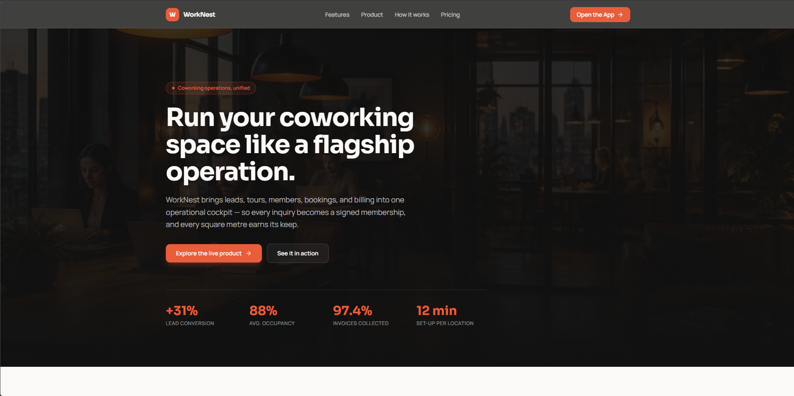

# Nestwise Workspace Operations


**Nestwise Workspace Operations** is an operations and member management platform built for modern coworking spaces and flexible work hubs. It streamlines the complete member journey from initial discovery to active membership, room reservations, invoicing, and facility analytics.

$$\text{Discovery} \longrightarrow \text{Inquiry} \longrightarrow \text{Tour} \longrightarrow \text{Membership} \longrightarrow \text{Bookings} \longrightarrow \text{Billing} \longrightarrow \text{Retention}$$



*The unified operations cockpit gives workspace managers real-time visibility into campus occupancy, active tour pipelines, space bookings, and daily recurring revenue.*

---

## Features

- **Public Marketing Showcase**: High-impact brand presence with space offerings, amenities, pricing tiers, and direct tour scheduling.
- **Operations Dashboard**: Real-time overview of current workspace occupancy, upcoming reservations, tour requests, and monthly revenue.
- **Leads & CRM Pipeline**: Multi-stage inquiry tracker (New, Contacted, Tour Booked, Converted, Lost) with audit logs and follow-up management.
- **Member & Membership Management**: Dedicated member directories, tier assignments (Hot Desk, Dedicated Desk, Private Office), and renewal histories.
- **Spaces & Resource Scheduling**: Interactive calendar and booking system for meeting rooms, phone booths, podcast studios, and event areas.
- **Billing & Financial Ledger**: Invoices, transactions, recurring membership dues, and payment statuses.
- **Occupancy & Analytics Cockpit**: Capacity utilization heatmaps, member velocity metrics, and revenue breakdown.

---

## Tech Stack

| Layer                    | Technology                                                                |
| :----------------------- | :------------------------------------------------------------------------ |
| **Full-Stack Framework** | [TanStack Start](https://tanstack.com/start) with React 19                |
| **Routing**              | [TanStack Router](https://tanstack.com/router) (file-based routing)       |
| **State & Data Caching** | [TanStack Query v5](https://tanstack.com/query)                           |
| **Bundler & Dev Server** | [Vite 8](https://vite.dev/)                                               |
| **Styling**              | [Tailwind CSS v4](https://tailwindcss.com/) with Charcoal & Ember palette |
| **UI Primitives**        | Radix UI Headless Components                                              |
| **Icons**                | [Lucide React](https://lucide.dev/)                                       |
| **Forms & Validation**   | React Hook Form + [Zod](https://zod.dev/)                                 |
| **Testing**              | [Vitest](https://vitest.dev/) + `@testing-library/react`                  |
| **Package Manager**      | [pnpm](https://pnpm.io/)                                                  |

---

## Project Structure

```text
nestwise-workspace-operations/
├── public/                     # Static assets and favicons
├── src/
│   ├── components/
│   │   ├── layout/             # Shell, sidebar, headers, navigation
│   │   └── ui/                 # Radix UI and Tailwind design system primitives
│   ├── features/               # Feature-specific modules
│   │   ├── analytics/          # Occupancy & utilization charts
│   │   ├── billing/            # Invoices, transactions, and metrics
│   │   ├── bookings/           # Space reservations and calendar views
│   │   ├── dashboard/          # Operations cockpit and summary widgets
│   │   ├── leads/              # Sales pipeline and lead cards
│   │   ├── members/            # Member roster and membership details
│   │   ├── settings/           # Location and organizational configuration
│   │   └── spaces/             # Room inventory and availability
│   ├── lib/
│   │   ├── api-client.ts       # Typed API client (local fixtures or live backend)
│   │   ├── mock-data.ts        # Built-in offline demo fixtures
│   │   └── utils.ts            # Class merging and formatting utilities
│   ├── routes/
│   │   ├── __root.tsx          # Root HTML layout and providers
│   │   ├── index.tsx           # Public marketing landing page
│   │   └── app/                # CRM & operations cockpit routes
│   │       ├── analytics.tsx
│   │       ├── billing.tsx
│   │       ├── bookings.tsx
│   │       ├── dashboard.tsx
│   │       ├── leads.tsx
│   │       ├── members.tsx
│   │       ├── settings.tsx
│   │       └── spaces.tsx
│   └── styles.css              # Global styles, fonts, and theme tokens
├── vitest.config.ts            # Vitest unit & integration test configuration
├── vite.config.ts              # Vite configuration
└── package.json                # Project dependencies and scripts
```

---

## Getting Started

### Prerequisites

- **Node.js**: v20 or newer
- **pnpm**: v9 or newer (`corepack enable pnpm` or `npm install -g pnpm`)

### Installation

```sh
# Clone the repository
git clone https://github.com/toxicbishop/nestwise-workspace-operations.git
cd nestwise-workspace-operations

# Install dependencies
pnpm install
```

### Development

Start the development server:

```sh
pnpm dev
```

The application will be running at `http://localhost:3000` (or the configured Vite port).

### Building for Production

```sh
# Typecheck and build the production bundle
pnpm build

# Preview the production build locally
pnpm preview
```

### Running Tests and Linting

```sh
# Run unit tests
pnpm test

# Run tests in watch mode
pnpm test:watch

# Lint codebase
pnpm lint

# Format codebase
pnpm format
```

---

## License

This project is licensed under the MIT License - see the [LICENSE](LICENSE) file for details.
